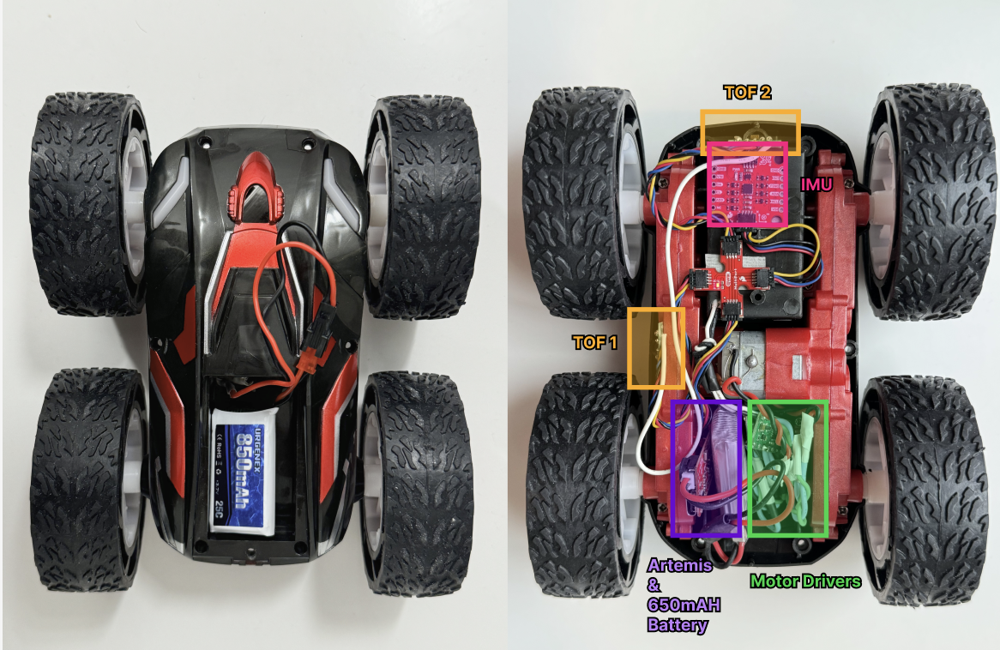

# Fast Robots

For Cornell’s ECE 4160 (Spring 2026), I converted an RC car into a robot that can flip near a wall, map an indoor arena, and follow a planned route. A SparkFun Artemis Nano reads an ICM-20948 inertial measurement unit and two VL53L1X time-of-flight sensors. The board controls the motors, while a Python host sends commands and collects telemetry over Bluetooth Low Energy.

[Lab reports](https://y1hhnn.github.io/FastRobots-2026/posts/) · [Flip demo](https://youtu.be/wNWp9pbFn4k) · [Navigation demo](https://youtu.be/wdNE80N9eK0)

## Experiments

- **Motion control.** I tuned PID controllers for wall distance and heading, then used a Kalman filter to estimate distance and speed between range readings. The car averaged 3.24 m/s at steady state across three full-throttle runs.
- **Mapping.** The car rotated in 20° increments at five known positions. Combining the range scans in a common coordinate frame produced a map of the arena walls and obstacles.
- **Navigation.** The host planned a nine-waypoint route with A* and sent one segment at a time. The car turned to each heading and drove for a calibrated duration. In physical trials, timing errors and occasional incorrect Bayesian position estimates limited waypoint accuracy.

## Code

- [Artemis firmware](ble_arduino/ble_arduino.ino) — sensor sampling, motor control, and onboard maneuvers.
- [Python interface and lab notebooks](ble_python/) — BLE commands, controller tuning, and experiment logs. The [segment test notebook](ble_python/lab12.ipynb) compares time-based and Kalman-based stopping.
- [Navigation mission notebook](https://github.com/Y1hhnn/FastRobots-2026/blob/simulator/notebooks/lab12_phase3.ipynb) — host-side planning, localization, and replanning on the `simulator` branch.
